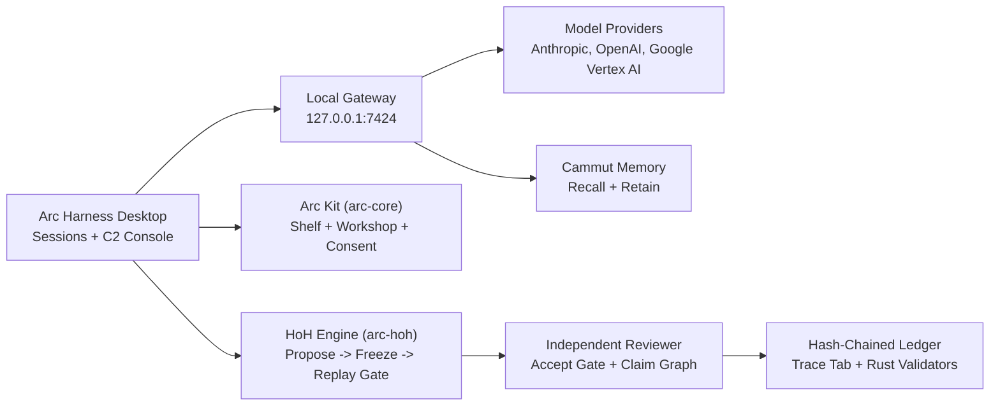
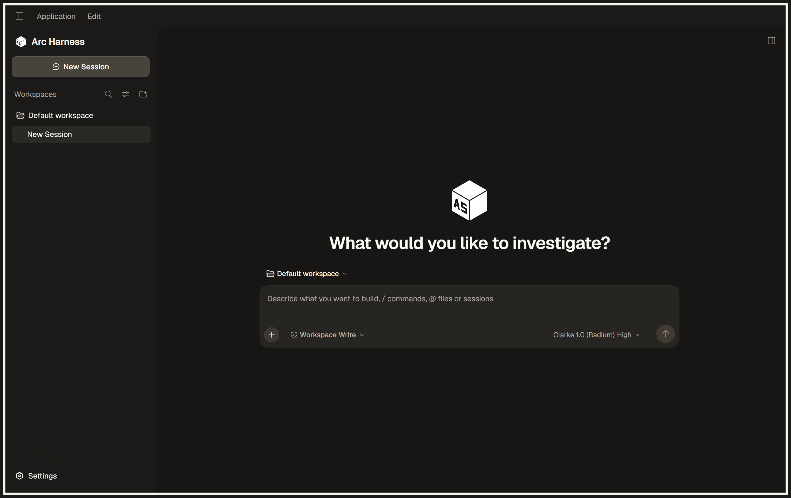
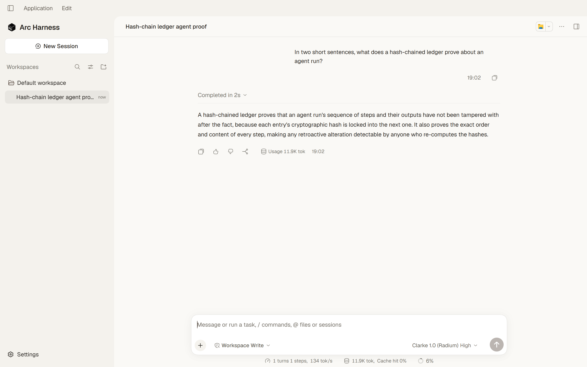
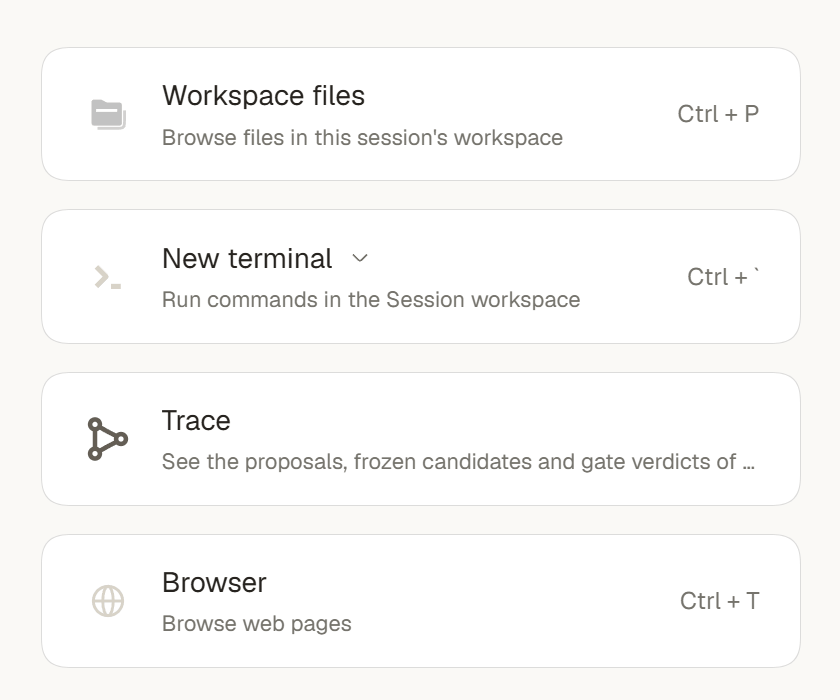
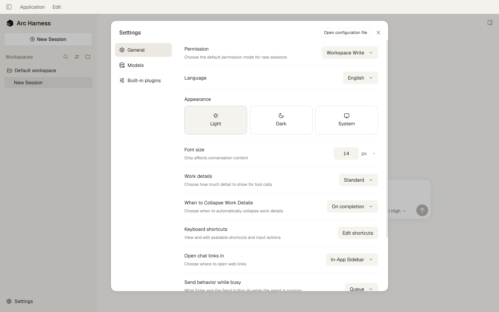

  <picture>
    <source media="(prefers-reduced-motion: reduce)" srcset="docs/images/header-still.svg">
    
  </picture>

Predict the future with the flow of your thoughts

  
  
  
  
  
  
  

  <a href="#capabilities">Capabilities</a> &nbsp;&nbsp;
  <a href="#architecture">Architecture</a> &nbsp;&nbsp;
  <a href="#plugins">Plugins</a> &nbsp;&nbsp;
  <a href="#screens">Screens</a> &nbsp;&nbsp;
  <a href="#roadmap">Roadmap</a> &nbsp;&nbsp;
  <a href="#install">Install</a> &nbsp;&nbsp;
  <a href="wiki/Home.md">Wiki</a>

## Overview

Arc Harness is a desktop workbench where AI models work in sessions. The agent reads and edits workspace files, runs shell commands under your permission mode, and calls tools. We built it as a scientific harness where the agent that writes a change never approves its own work.

This repository holds the build kit, six Arc plugins, the C2 console, Windows installer tools, benchmark runners, and Rust validators. You supply your own installed copy of the original 0.2.1-rc.5 app in `pristine/`.

## Capabilities

| Capability | What runs in version 0.5.0 |
|---|---|
| **Independent verification** | Tasks pass propose, freeze, and an independent accept gate in `arc-hoh`. Each step enters a hash-chained ledger checked every 5 seconds in Trace. |
| **Statistical gates** | `arc-hoh` adds held-out patch replay gates, Bayesian hypothesis trees, claim graphs, Dawid-Skene source reliability, branch budgets, and Brier-scored intuition routing. |
| **Unified C2 console** | `arc-core` joins Research, Memory, Molecullage, and Prose workspaces with Servers, Keys, Apps, Audit, 30-day consent grants, and six MCP tools. |
| **Molecullage studio** | `arc-molecullage` connects the 231-source library, eight-domain software atlas, five-gate anti-overplating check, and 3D molecular and Blender figure pipeline. |
| **Chat diagrams** | `arc-mermaid` renders `flowchart`, `stateDiagram`, and `sequenceDiagram` code blocks in chat with Molecullage layout gates and SVG or PNG export. |
| **Paper look and intro** | `arc-theme` and `tools/build.mjs` ship the `#faf9f6` paper and `#171614` dark palette, 24 px menu blur, and a skippable 7.4 s intro. |
| **Gemini tool continuity** | `tools/build.mjs` captures and replays `extra_content.google.thought_signature` on streamed and parallel tool calls for multi-turn Vertex AI and Gemini sessions. |
| **Zero vendor telemetry** | Vendor sign-in, telemetry rows, and remote update feeds are disabled at build time and verified by static and live network traces. |
| **Rust native guards** | `native/arc-validators` checks SHA-256 digests, prose rules, secret scans, SVG icon bounds, network grants, and seal boundaries with zero external crates. |

## Architecture

A provider configured with its own API key on the Models page connects directly from the desktop host. Gateway routes pass through `127.0.0.1:7424`, where credentials stay outside workspace files and unsafe writes are refused. Five clips in [`media/`](media/README.md) show the five-gate AND chain ([`gates.gif`](media/gates.gif)), rank fusion ([`ranking.gif`](media/ranking.gif)), patch replay ([`better.mp4`](media/better.mp4)), distillation ([`student.mp4`](media/student.mp4)), and context compression ([`context.mp4`](media/context.mp4)).

## Plugins

| Plugin | Version | Role |
|---|---|---|
| [`plugins/arc-hoh`](plugins/arc-hoh/README.md) | `0.4.0` | Propose/freeze/accept gate, patch replay gate, hypothesis tree, claim graph, Dawid-Skene reliability, branch budgets, Intuition Router, ledger, and Trace tab. |
| [`plugins/arc-core`](plugins/arc-core/README.md) | `0.2.0` | Shared Arc Kit MCP server, C2 unified console, 30-day consent dialog, Shelf search, Workshop toolpacks, and SSH memory deployment. |
| [`plugins/arc-theme`](plugins/arc-theme/README.md) | `0.6.0` | Paper, Black and white, and Radium themes, Geist fonts, 24 px menu blur, Settings copy map, and startup intro. |
| [`plugins/arc-mode`](plugins/arc-mode/README.md) | `0.2.0` | Advanced settings page with the Arc Harness mode switch, installed rules, hooks, and skills inventory, and benchmark tables. |
| [`plugins/arc-molecullage`](plugins/arc-molecullage/README.md) | `0.1.0` | Molecullage workspace with the 231-source library, eight-domain software atlas, five-gate anti-overplating check, and 3D figure pipeline. |
| [`plugins/arc-mermaid`](plugins/arc-mermaid/README.md) | `0.2.0` | Deterministic Mermaid renderer for flowcharts, state diagrams, and sequence diagrams in chat code blocks, gated by Molecullage layout checks. |

## Screens

Desktop captures generated by `test/desktop-journey.mjs --mode shots`:

| | |
|---|---|
|  |  |
| **Home (light).** Start a workspace session on the cream `#faf9f6` paper canvas. | **Home (dark).** Warm `#171614` dark palette selectable alongside Light and System. |
|  |  |
| **Session (light).** Live session transcript with Geist typography and ink controls. | **Side panels.** Workspace files, terminal, Trace ledger, and browser beside the chat. |
|  |  |
| **Session (dark).** Live model reply in the warm dark theme. | **Models.** Connect providers and keys directly in Settings. |
|  | |
| **General settings.** Appearance selector, theme switcher, and shell preferences. | |

## Roadmap

Full phase details and proof gates live in [`wiki/Roadmap.md`](wiki/Roadmap.md).

| Phase | Scope | Status in 0.5.0 | Verification |
|---|---|---|---|
| **0. Working basics** | Gateway recovery, Google Vertex route, Gemini `thought_signature` replay, skippable 7.4 s intro, one-gradient status text. | Built | `build-check.mjs` and `desktop-journey.mjs` |
| **1. Lean Arc Harness** | Ten unused screens switched off, coding-view row removed, Trace sidebar tab, reversible `~/.arc` install. | Built | Three-phase `ui-crawl.mjs --lean` |
| **1b. Unified C2 console** | Built-in plugins removed from Settings; Research, Memory, Molecullage, and Prose unified with Servers, Keys, Apps, and Audit. | Built | `plugins/arc-core/test/ui-panel.test.mjs` |
| **2. Memory upgrade** | Five-label note policy, secret rejection, near-twin supersede, fail-open Cammut breaker, and TOFU SSH server deployment. | Built | `plugins/arc-core/test/core.test.mjs` |
| **3. Claims and rating** | Patch replay gate, Bayesian hypothesis tree, claim graph, Dawid-Skene reliability, branch budgets, and Intuition Router. | Built | `plugins/arc-hoh/test/*.test.mjs` |
| **4. Arc Kit and studios** | `arc-core` MCP, Shelf corpus, Workshop signal router, `arc-molecullage` studio, and `arc-mermaid` chat diagram engine. | Built | 100+ unit and layout audit tests |
| **5. Benchmark proof** | Startup baseline (`measure-start.mjs`) and headless runner (`bench-runner.mjs`) built; public benchmark campaign open. | Runners built | `measure-start` and `bench-runner` self-tests |
| **6. Native and public** | Windows installer (`package.mjs`, `arc-harness.iss`), vendored bundle audit, loopback gateway, and Rust `arc-validators` built; source fork open. | Core slices built | `native-transition.test.mjs` and `cargo test` |

## Install

You need Windows 10 or 11 (64-bit), Node.js 22.19 or newer, and an installed copy of the original 0.2.1-rc.5 app (see [Credit](#credit)). Rust (`cargo`) is optional and runs the `native/arc-validators` suite.

1. Copy `app.asar`, `app-update.yml`, `icon.png`, and `tray.ico` from the `resources` folder of the original 0.2.1-rc.5 app into `pristine/`.
2. Check SHA-256 hashes against `pristine/SHA256SUMS.txt`.
3. Run `node tools/build.mjs` to apply all archive patches and write `build/app.asar` and `build/BUILD.json`.
4. Run `npm run test:archive` to check every patched script, manifest digest, and brand asset.
5. Close the running app and run `install.cmd` (or `install.cmd rollback` to restore the original files).
6. Copy the plugin folders from `plugins/` (`arc-hoh`, `arc-theme`, `arc-core`, `arc-mode`, `arc-molecullage`, `arc-mermaid`) into `~/.arc/profiles/web/node_modules` and `~/.arc/profiles/desktop/node_modules`.
7. Run `node tools/lean-profile.mjs apply` to enable the core bundles and installed Arc plugins in both profiles (`restore` reverts the bundle list).
8. Optional installer: run `node tools/package.mjs [--rcedit <rcedit-x64.exe>] [--iscc <ISCC.exe>]` to build `build/Arc-Harness-Setup-0.5.0.exe` from `installer/arc-harness.iss`.

Set `ARC_RESOURCES` or `ARC_APP_DIR` when your base installation lives outside the default folder.

## Checks

| Check | Command |
|---|---|
| Full Node suite (syntax, kit, all 6 plugins, benchmarks, native transition, privacy self-test) | `npm test` |
| Rust zero-dependency validator suite | `cargo test --manifest-path native/arc-validators/Cargo.toml` |
| Archive check (15,013 manifest hashes, brand rules, positive control) | `npm run test:archive` |
| Headless three-phase screen crawl (first run, dark, light) | `node test/ui-crawl.mjs --lean` |
| Live network isolation trace | `node test/no-deepseek-net.mjs --live` |
| Real desktop journey (Settings, live model reply, gateway retry) | `node test/desktop-journey.mjs --mode settings` |
| Repository privacy and deny-list scan | `npm run scan` |

## Project health

| Document | Purpose |
|---|---|
| [Contributing](CONTRIBUTING.md) | Patch rules, coding standards, and pre-push checks |
| [Security policy](SECURITY.md) | Private vulnerability reporting |
| [Code of conduct](CODE_OF_CONDUCT.md) | Community standards |
| [Changelog](CHANGELOG.md) | Versioned release history (`0.1.0` to `0.5.0`) |
| [Citation](CITATION.cff) | Metadata for citing Arc Harness `0.5.0` |
| [Wiki](wiki/Home.md) | Setup guides, Cammut connection, memory policy, and architecture notes |

GitHub Actions workflows pin every action to a 40-character commit SHA. Every push and pull request runs both the Node 24 suite and the Rust validator suite.

## Limits

- User data lives in `~/.arc` (override with `ARC_HOME`). First install copies `~/.dsh` into `~/.arc` while leaving `~/.dsh` untouched for `install.cmd rollback`.
- In-place `install.cmd` updates `resources/app.asar` inside the existing app folder. Use `node tools/package.mjs` with `rcedit` and Inno Setup to build `Arc Harness.exe`.
- Internal CSS variable prefixes (`dsw-` and `ds-`) and third-party model identifiers in the upstream provider catalog stay unchanged for compatibility.
- The local gateway (`127.0.0.1:7424`) and Cammut server run as separate processes. `lib/native/cammut-gateway.mjs` provides the loopback host module for Phase 6.
- Automated live checks run on Windows; macOS and Linux builds are untested.

## Credit

Arc Harness builds on [DeepSeek Harness](NOTICE.md) 0.2.1-rc.5 under the MIT License. Arc Harness is an independent open-source project and has no affiliation with the upstream publisher.

Code in this repository is licensed under MIT (`LICENSE`). Geist and Geist Mono are licensed under the SIL Open Font License 1.1 (`THIRD_PARTY_LICENSES/`). The AS cube emblem is excluded from the MIT grant, as noted in `NOTICE.md`.
