<p align="center">
  <picture>
    <source media="(prefers-reduced-motion: reduce)" srcset="docs/images/header-still.svg">
    
  </picture>
</p>

<p align="center">Predict the future with the flow of your thoughts</p>

<p align="center">We build AI-driven computational biology and chemistry around advanced harness-gated approach where the environment make our results humanely acceptable, verifiable and reliable.</p>

<p align="center">
  <a href="../../releases/tag/v0.6.0"></a>
  <a href="../../actions/workflows/ci.yml"></a>
  <a href="#plugins"></a>
  <a href="LICENSE"></a>
  <a href="#quick-start"></a>
  <a href="SECURITY.md"></a>
  <a href="CHANGELOG.md"></a>
  <a href="CITATION.cff"></a>
</p>

<p align="center">
  <a href="#overview">Overview</a> &nbsp;&nbsp;
  <a href="#architecture">Architecture</a> &nbsp;&nbsp;
  <a href="#core-systems">Core systems</a> &nbsp;&nbsp;
  <a href="#plugins">Plugins</a> &nbsp;&nbsp;
  <a href="#quick-start">Quick start</a> &nbsp;&nbsp;
  <a href="#verification">Verification</a> &nbsp;&nbsp;
  <a href="#interface">Interface</a> &nbsp;&nbsp;
  <a href="#roadmap">Roadmap</a> &nbsp;&nbsp;
  <a href="wiki/Home.md">Wiki</a>
</p>

---

## Overview

Arc Harness checks scientific claims one at a time, and the model that built a claim never signs it. Models read and edit workspace files, run shell commands under explicit permission modes, retrieve web documents, and query shared memory, while every non-trivial change passes through an independent verification gate run by a separate model family or deterministic validator.

This repository ships the **Arc Harness 0.6.0** build kit. It contains seven built-in plugins, the unified C2 console, the 1M Library memory index, and the tiered web crawler. It also includes the native Go loopback gateway, six zero-dependency Rust validators, headless benchmark runners, and Windows release packaging tools. Every package, plugin, binary, Electron archive, and release bundle shares one canonical version in [`VERSION`](VERSION), enforced in CI by [`scripts/version-sync.mjs`](scripts/version-sync.mjs).

<table>
  <tr>
    <td width="50%">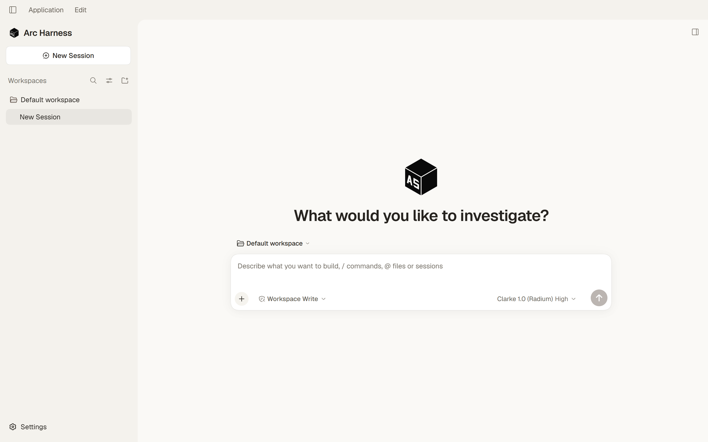</td>
    <td width="50%">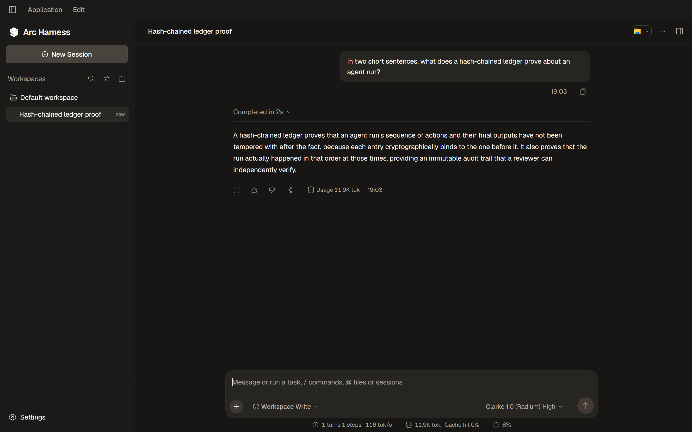</td>
  </tr>
  <tr>
    <td><strong>Paper workbench (Light).</strong> Cream <code>#faf9f6</code> canvas, Geist typography, ink controls, and zero vendor telemetry.</td>
    <td><strong>Live session (Dark).</strong> Warm <code>#171614</code> surface, streaming reasoning, and side-by-side workspace tools.</td>
  </tr>
</table>

## Architecture

Arc Harness separates interactive session work, provider credentials, web retrieval, shared memory, and deterministic verification into explicit local boundaries. Model API keys stay behind the loopback Go gateway on `127.0.0.1:7424` and never enter workspace files.

<p align="center">
  <picture>
    <source media="(prefers-color-scheme: dark)" srcset="docs/images/architecture-dark.svg">
    <source media="(prefers-color-scheme: light)" srcset="docs/images/architecture-light.svg">
    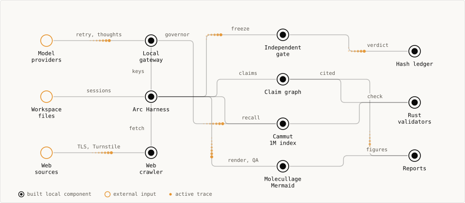
  </picture>
</p>

- **Desktop shell and seven plugins**: `arc-core`, `arc-hoh`, `arc-web-crawler`, `arc-molecullage`, `arc-mermaid`, `arc-theme`, and `arc-mode` mount over Cordis with unified `0.6.0` versioning and zero external marketplace calls.
- **Native Go gateway (`native/arc-gateway`)**: a single Windows background binary serving `/vertex/v1`, `/radium/v1`, `/merge/v1`, `/gc/v1`, `/timeweb/v1`, and `/cammut/mcp`. It translates Vertex AI streaming thoughts into `reasoning_content`, captures and replays Gemini `thought_signature` tokens, and compresses large requests with gzip. During long thinking pauses it emits SSE keepalive heartbeats. On transient HTTP 429, 409, and 503 responses it retries up to 5 times with jittered backoff, and normalizes remaining 429 bursts to `rate_limit_exceeded` JSON so downstream retry policies finish cleanly.
- **Zero-dependency Rust validators (`native/arc-validators`)**: verifies SHA-256 digests, prose rules, secret boundaries, SVG icon bounds, network grants, and seal checks with no external crates.

## Core systems

### Independent verification

`plugins/arc-hoh` implements Harness-of-Harness and Harness² verification cycles directly inside the desktop host. A builder agent records its hypothesis, untouched boundary, acceptance checks, and edge probes (`hoh_propose`), hashes the candidate files (`hoh_freeze`), and hands verification to an independent reviewer (`hoh_gate`). Every event appends to a SHA-256 hash-chained ledger inspected live in the Trace sidebar tab.

<p align="center">
  <picture>
    <source media="(prefers-color-scheme: dark)" srcset="docs/images/verification-dark.svg">
    <source media="(prefers-color-scheme: light)" srcset="docs/images/verification-light.svg">
    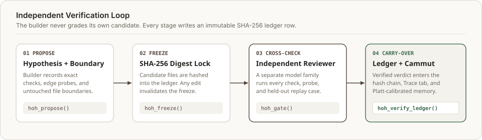
  </picture>
</p>

<p align="center">
  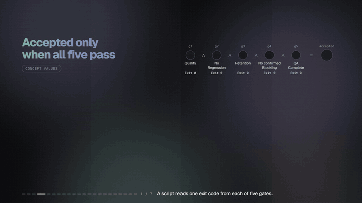
</p>

Alongside the accept gate, `arc-hoh` includes held-out patch replay gates (`lib/replay.js`), Bayesian hypothesis trees (`lib/tree.js`), claim dependency graphs (`lib/claims.js`), Dawid-Skene source reliability (`lib/reliability.js`), branch budget allocation (`lib/budget.js`), and a Brier-calibrated Intuition Router (`lib/intuition.js`).

### Unified console and memory index

`plugins/arc-core` combines Research, Memory, Molecullage, and Prose workspaces with Servers, Keys, Apps, Audit, 30-day consent grants, and seven MCP tools (`shelf_search`, `claim_record`, `gate_check`, `toolpack_load`, `memory_retain`, `memory_recall`, `prose_check`).

Its write-once **1M Library reader** (`lib/library-index.js`) deduplicates notes by SHA-256 without re-tokenizing, serves warm queries with zero cold raw-body reads, links stale notes via write-time supersession while preserving explicit date pins, and calibrates widening thresholds with 2-fold out-of-fold Platt scaling.

<p align="center">
  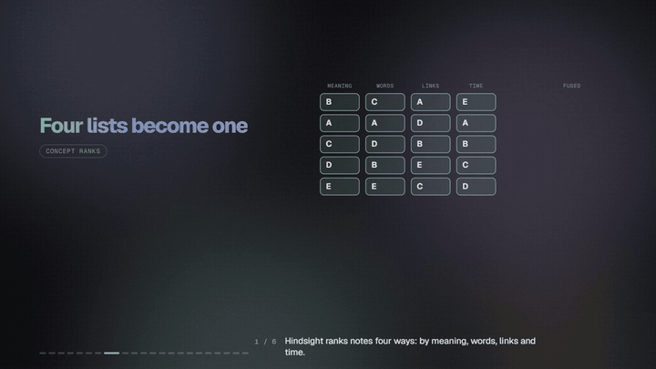
</p>

### Tiered web crawler and CAPTCHA verifier

`plugins/arc-web-crawler` provides Arc Harness's native `web_search` and `web_fetch` provider (`arc-crawler`) plus `web_analyze` and `web_crawl` tools with clean Markdown rendering and native web cards:

| Stage | Engine | Behaviour |
|---|---|---|
| **Search** | `ddgs` + optional SearXNG + stealth HTML fallback | Keyless metasearch returning deduplicated, structured sources. |
| **Tier 1 fetch** | `curl_cffi` Chrome TLS impersonation | Fast HTTP retrieval with manual bounded redirects validating every hop against loopback, private, and link-local SSRF targets; direct PDF text extraction via PyMuPDF. |
| **Tier 2 stealth** | Scrapling `StealthyFetcher` on Patchright Chromium | Automatic escalation on HTTP 403/429/503, WAF blocks, JS-only SPAs, and Cloudflare Managed/Turnstile challenges with per-host cookie caching. |
| **Tier 3 verifier** | Structured challenge classifier + optional visible browser | Classifies Cloudflare Turnstile, Akamai, AWS WAF, DataDome, PerimeterX, reCAPTCHA, and hCaptcha without false positives on normal pages; supports opt-in visible verification (`interactive_captcha: true`) and clean Markdown extraction via Trafilatura and BeautifulSoup. |

### Molecullage studio and chat diagrams

`plugins/arc-molecullage` connects a 231-source scientific asset library, an eight-domain software atlas, an interactive five-gate anti-overplating checker, and a 3D molecular and Blender figure workflow inside the right sidebar. `plugins/arc-mermaid` renders `flowchart`, `stateDiagram`, and `sequenceDiagram` code blocks deterministically in chat with SVG and PNG export gated by Molecullage layout and colour-vision checks.

## Plugins

Every built-in plugin ships at unified Arc Harness version **`0.6.0`**:

| Plugin | Version | Role |
|---|---|---|
| [`plugins/arc-hoh`](plugins/arc-hoh/README.md) | `0.6.0` | Propose, freeze, and accept gate, held-out replay gate, hypothesis tree, claim graph, Dawid-Skene reliability, branch budgets, Intuition Router, and interactive Trace tab. |
| [`plugins/arc-core`](plugins/arc-core/README.md) | `0.6.0` | C2 unified console, write-once SHA-256 1M Library index, seven MCP tools, 30-day consent dialog, Shelf search, Workshop toolpacks, and TOFU SSH memory deployment. |
| [`plugins/arc-web-crawler`](plugins/arc-web-crawler/README.md) | `0.6.0` | Open-source keyless web search, 3-tier stealth TLS/Patchright fetcher, Cloudflare Turnstile and CAPTCHA verifier, PDF/Markdown analyzer, and bounded same-origin crawler. |
| [`plugins/arc-molecullage`](plugins/arc-molecullage/README.md) | `0.6.0` | Interactive Molecullage studio with 231-source atlas filtering, pinned sources, five-gate figure check runner, and 3D structure/Blender pipeline controls. |
| [`plugins/arc-mermaid`](plugins/arc-mermaid/README.md) | `0.6.0` | Deterministic Mermaid SVG/PNG renderer in chat code blocks gated by Molecullage layout, contrast, and colour-vision checks. |
| [`plugins/arc-theme`](plugins/arc-theme/README.md) | `0.6.0` | Paper (`#faf9f6`), Dark (`#171614`), Black and white, and Radium themes, Geist fonts, 24 px menu blur, Settings copy map, and skippable 7.4 s intro. |
| [`plugins/arc-mode`](plugins/arc-mode/README.md) | `0.6.0` | Advanced settings page with Arc Harness mode toggle, live rules/hooks/skills inventory, and measured benchmark tables. |

## Quick start

### Requirements

- Windows 10 or 11 (64-bit) and Node.js 22.19 or newer
- An installed copy of the base 0.2.1-rc.5 Electron shell in `pristine/` (see [Credit](#credit))
- Optional: Go 1.24+ (`native/arc-gateway`), Rust `cargo` (`native/arc-validators`), Python 3.11+ with `scrapling[fetchers]`, `trafilatura`, `ddgs`, `pymupdf` (`plugins/arc-web-crawler`)

### Install from release bundle

Download **`Arc-Harness-Kit-0.6.0-win-x64.zip`** and **`SHA256SUMS.txt`** from [GitHub Releases](../../releases/tag/v0.6.0), verify the archive digest, extract the kit, and run the build and install steps below. The release bundle includes precompiled `bin/arc-gateway.exe` and `bin/arc-validators.exe` alongside all seven `0.6.0` plugins.

### Update an installed copy

The **Updates** panel of the C2 console reads the latest GitHub release, compares it with the installed version, and can replace the seven plugins and the `arc-gateway.exe` and `arc-validators.exe` programs. Modes are `off`, `notify` (default) and `auto`; a manual check, update and roll back always work. The kit zip is checked against `SHA256SUMS.txt` and every file against `RELEASE-MANIFEST.json` before anything is swapped, and the old files are kept for one roll back. The checksum file comes from the same release, so it proves a complete download, not who built it. The updater does not change `app.asar` or your data in `~/.arc`. Details: [wiki, Install](wiki/Install.md#update-plugins-and-programs).

### Build from source

```powershell
# 1. Verify syntax, unified 0.6.0 versioning, and all unit suites
npm test
cargo test --manifest-path native/arc-validators/Cargo.toml
go test -C native/arc-gateway ./...

# 2. Place base resources (app.asar, app-update.yml, icon.png, tray.ico) in pristine/
#    and build the clean-room Arc Harness 0.6.0 archive
node tools/build.mjs
npm run test:archive

# 3. Close Arc Harness and install in place (or run `install.cmd rollback` to undo)
.\install.cmd

# 4. Enable the lean core and installed Arc plugins across profiles
node tools/lean-profile.mjs apply

# 5. Optional: build the self-contained release bundle or Inno Setup installer
npm run release:bundle
node tools/package.mjs --rcedit path\to\rcedit-x64.exe --iscc path\to\ISCC.exe
```

Set `ARC_RESOURCES` or `ARC_APP_DIR` if your base installation lives outside the default user directory, and `ARC_HOME` to override `~/.arc`.

## Verification

Every pull request runs SHA-pinned GitHub Actions workflows across Node 24, Rust, Go, and spawn/privacy audits.

| Suite | Scope | Command |
|---|---|---|
| **Core Node and plugin suite** | Syntax, version sync, icon/header SVG checks, all 7 plugins, native transition, workflows, science bench, privacy self-test | `npm test` |
| **Native Go gateway** | Route auth, Cammut governor, Vertex streaming thoughts, gzip, heartbeat, 5x 429 retry and `rate_limit_exceeded` normalization | `go test -C native/arc-gateway -count=1 ./...` |
| **Native Rust validators** | 6 zero-dependency modules (`sha256`, `arc_rules`, `arc_scan`, `arc_hook`, `vector_assets`, `seal_guard`, `grants_net`) | `cargo test --manifest-path native/arc-validators/Cargo.toml` |
| **Windowless spawn audit** | Verifies `windowsHide: true` and Windows `CREATE_NO_WINDOW` across `lib/`, `plugins/`, `scripts/`, `tools/`, `brandtext/`, `theme/`, and Go gateway | `node tools/check-spawns.mjs` |
| **Archive integrity** | 15,013 manifest hashes, brand rules, independent scan, positive control | `npm run test:archive` |
| **Headless UI crawl** | Three-phase screen verification (first run, dark, light) | `node test/ui-crawl.mjs --lean` |
| **Calibrated science bench** | Cross-family headless MCQ benchmark with per-family USD spend reservations and 2-fold OOF Platt Brier score | `node tools/science-bench.mjs --self-test` |
| **Network isolation trace** | Static and live check confirming zero vendor telemetry or unintended hosts | `node test/no-deepseek-net.mjs --live` |

## Interface

Captures from the desktop build across light paper mode, warm dark mode, workspace panels, and Settings:

<table>
  <tr>
    <td width="50%">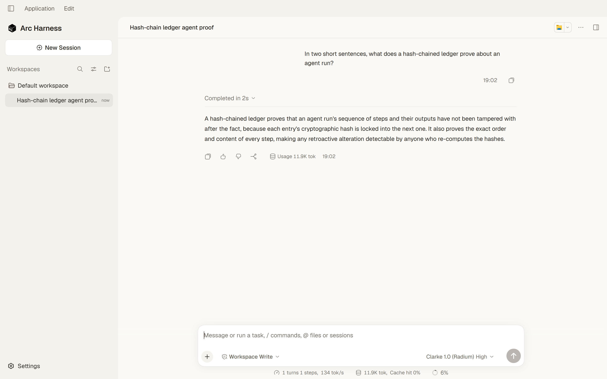</td>
    <td width="50%">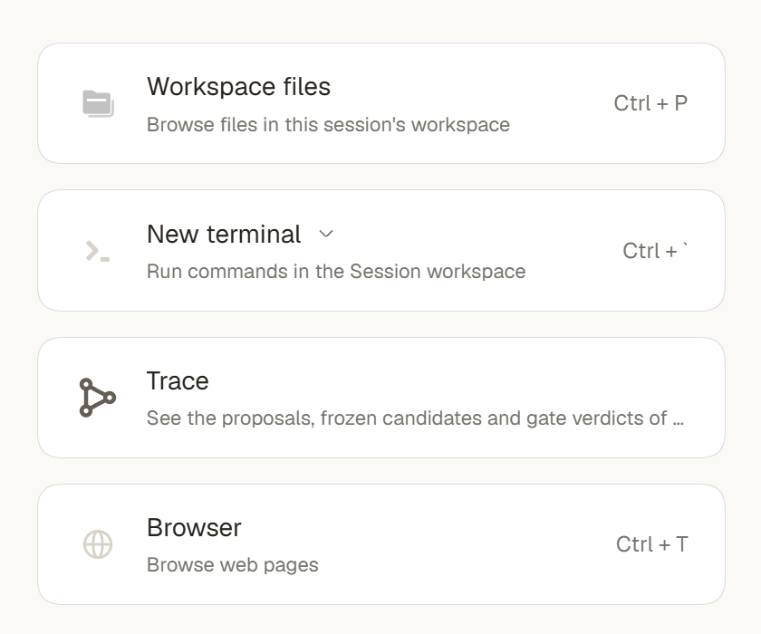</td>
  </tr>
  <tr>
    <td><strong>Session transcript (Light).</strong> Structured tool cards, Markdown rendering, and Geist ink controls.</td>
    <td><strong>Side panels.</strong> Workspace files, terminal, Trace ledger, C2 Console, and Molecullage beside the chat.</td>
  </tr>
  <tr>
    <td width="50%">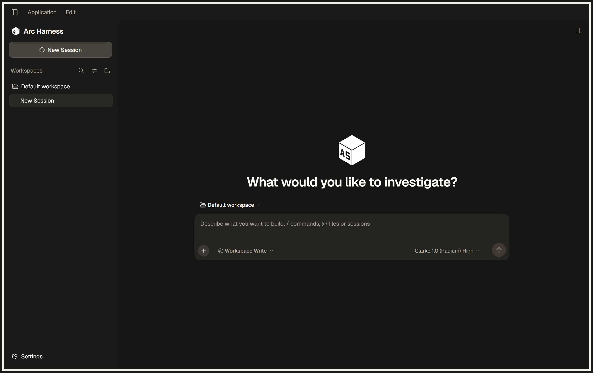</td>
    <td width="50%">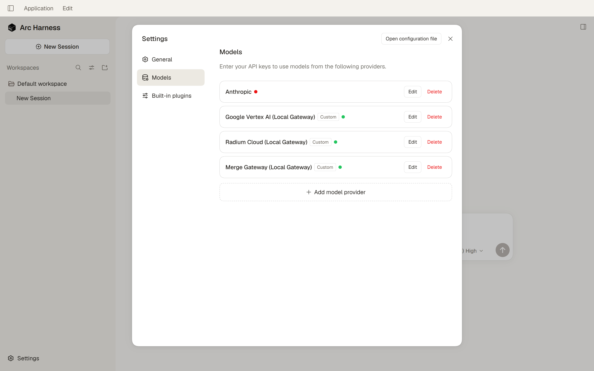</td>
  </tr>
  <tr>
    <td><strong>Home (Dark).</strong> Warm <code>#171614</code> palette selectable alongside Light and System.</td>
    <td><strong>Models.</strong> Connect Anthropic, OpenAI, Google Vertex AI, and local gateway routes.</td>
  </tr>
  <tr>
    <td width="50%">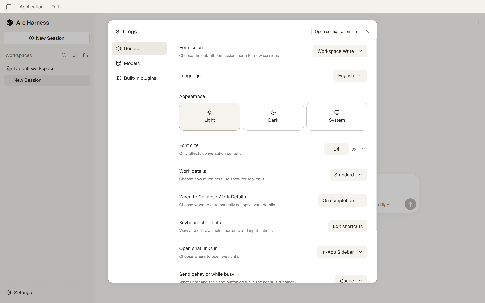</td>
    <td width="50%">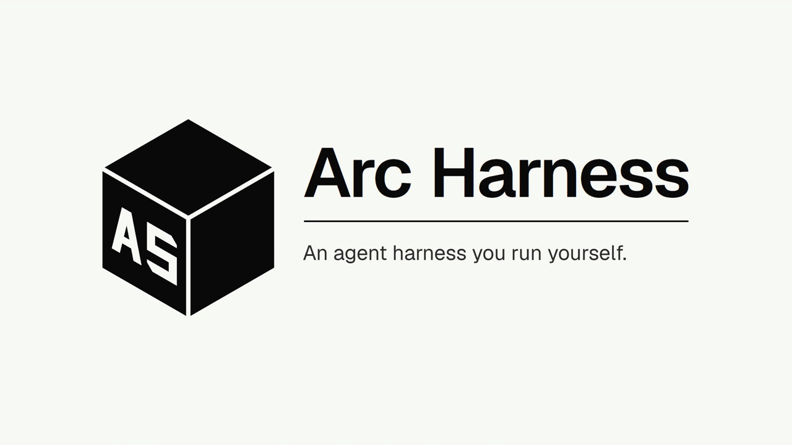</td>
  </tr>
  <tr>
    <td><strong>General settings.</strong> Theme selector, appearance controls, and shell options.</td>
    <td><strong>Startup sequence.</strong> Immediate window reveal with skippable 7.4 s AS cube intro.</td>
  </tr>
</table>

Five additional workflow recordings live in [`media/`](media/README.md): [`gates.gif`](media/gates.gif), [`ranking.gif`](media/ranking.gif), [`better.mp4`](media/better.mp4), [`student.mp4`](media/student.mp4), and [`context.mp4`](media/context.mp4).

## Roadmap

Full phase proofs and checklists live in [`wiki/Roadmap.md`](wiki/Roadmap.md).

| Phase | Scope | Status in 0.6.0 | Verification |
|---|---|---|---|
| **0. Working basics** | Loopback Go gateway, Vertex streaming thoughts, 5x 429 retry and `rate_limit_exceeded` normalization, gzip, heartbeats, skippable intro. | Shipped | `go test`, `build-check.mjs`, `desktop-journey.mjs` |
| **1. Lean workbench** | Unused screens disabled, Trace sidebar tab, reversible `~/.arc` home, unified `VERSION` (`0.6.0`) across app and kit. | Shipped | `version-sync.mjs`, `ui-crawl.mjs --lean` |
| **1b. Interactive C2 console** | Research, Memory, Molecullage, and Prose workspaces with owner notes, verdicts, pins, 30-day consent, and draft protection. | Shipped | `plugins/arc-core/test/ui-panel.test.mjs` |
| **2. Memory and 1M index** | Five-label policy, secret rejection, SHA-256 write-once 1M Library reader, supersession linking, Platt router, TOFU SSH deploy. | Shipped | `plugins/arc-core/test/library-index.test.mjs` |
| **3. Verification engine** | Propose/freeze/accept gate, held-out patch replay, Bayesian hypothesis tree, claim graph, Dawid-Skene reliability, Intuition Router. | Shipped | `plugins/arc-hoh/test/*.test.mjs` |
| **4. Studios and open web** | `arc-molecullage` studio, `arc-mermaid` diagram engine, and `arc-web-crawler` tiered stealth fetcher and Turnstile verifier. | Shipped | `crawler.test.mjs`, `molecullage.test.mjs`, `arc-mermaid` |
| **5. Benchmark proof** | Startup baseline (`measure-start.mjs`), `bench-runner.mjs`, and calibrated cross-family `science-bench.mjs` built; public campaign open. | Runners shipped | `science-bench.test.mjs`, `--self-test` |
| **6. Native and release** | `release-bundle.mjs`, Windows Inno Setup packager, vendored bundle license audit, and zero-dep Rust `arc-validators` shipped; standalone source fork open. | Core slices shipped | `native-transition.test.mjs`, `cargo test` |

## Governance and security

| Resource | Purpose |
|---|---|
| [Changelog](CHANGELOG.md) | Release history from `0.1.0` through `0.6.0` |
| [Security policy](SECURITY.md) | Private vulnerability reporting and threat boundaries |
| [Contributing](CONTRIBUTING.md) | Patch rules, spawn audit, and pre-push checks |
| [Code of conduct](CODE_OF_CONDUCT.md) | Community standards |
| [Citation](CITATION.cff) | Machine-readable citation metadata for `0.6.0` |
| [Wiki](wiki/Home.md) | Architecture notes, model routing, Cammut setup, and troubleshooting |

## Limits

- Automated live desktop checks and installer packaging target Windows x64; macOS and Linux builds are not yet verified.
- User data lives in `~/.arc` (override with `ARC_HOME`). First install copies legacy data while keeping the original directory intact for `install.cmd rollback`.
- Internal CSS variable prefixes (`dsw-`, `ds-`) and third-party model identifiers remain unchanged for upstream runtime compatibility.
- The Go gateway (`127.0.0.1:7424`) and Cammut server run as separate local processes.

## Citation

If you use Arc Harness in research or software engineering work, cite [`CITATION.cff`](CITATION.cff):

```bibtex
@software{arc_harness_2026,
  title   = {Arc Harness: a desktop AI harness that never grades its own work},
  author  = {{Arc Harness contributors}},
  version = {0.6.0},
  year    = {2026},
  url     = {https://github.com/danilkotelnikov/Arc-Science},
  license = {MIT}
}
```

## Credit

Arc Harness builds on [DeepSeek Harness](NOTICE.md) 0.2.1-rc.5 under the MIT License. Arc Harness is an independent open-source project with its own versioning (`0.6.0`) and has no affiliation with the upstream publisher.

Code in this repository is licensed under MIT ([`LICENSE`](LICENSE)). Geist and Geist Mono are licensed under the SIL Open Font License 1.1 ([`THIRD_PARTY_LICENSES/`](THIRD_PARTY_LICENSES/)). The AS cube emblem is excluded from the MIT grant, as noted in [`NOTICE.md`](NOTICE.md).
