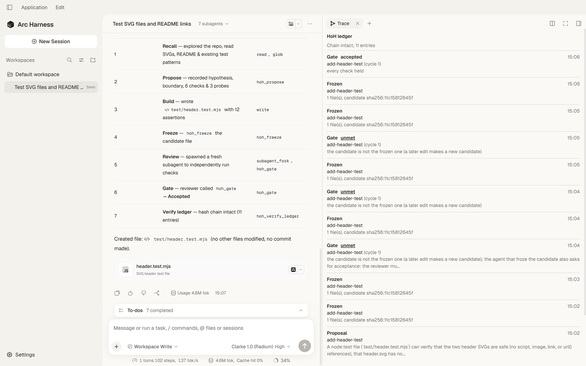
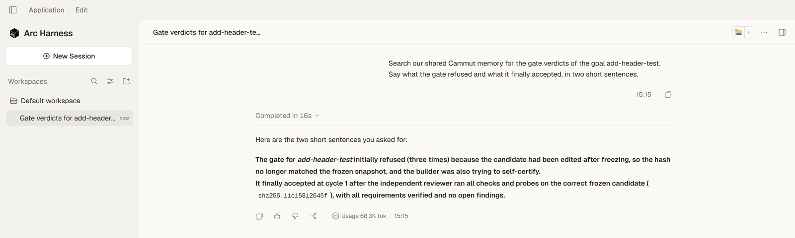
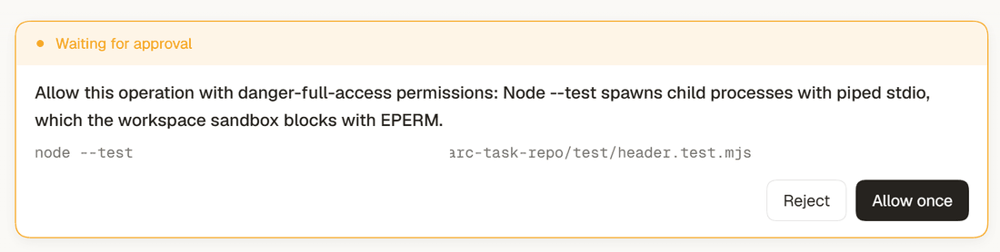
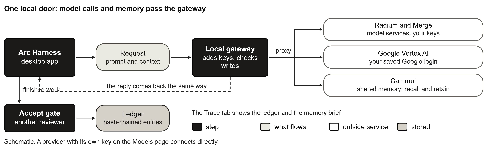
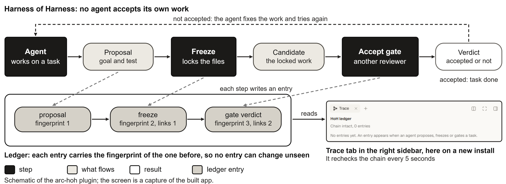
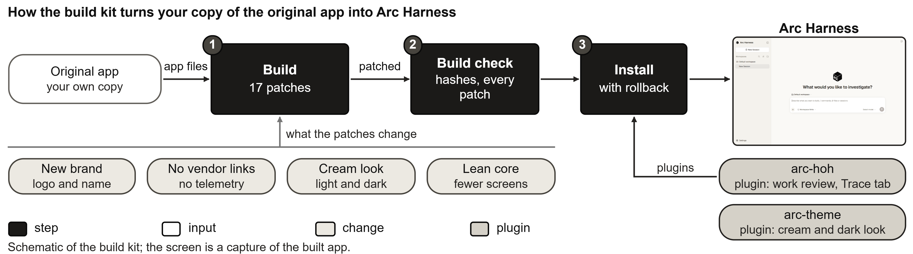
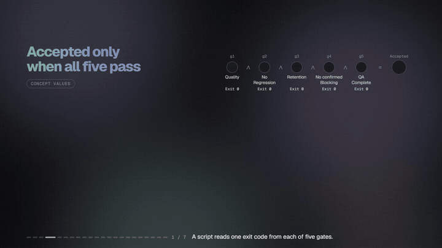
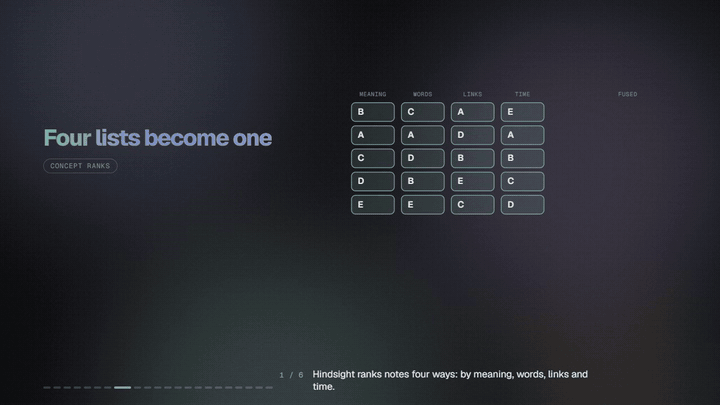
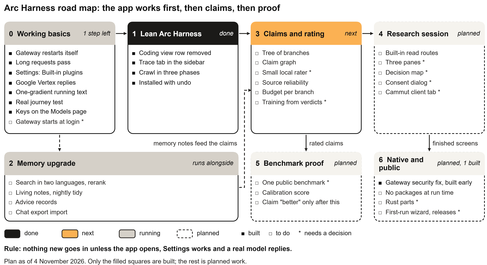

  <picture>
    <source media="(prefers-reduced-motion: reduce)" srcset="docs/images/header-still.svg">
    
  </picture>

Predict the future with the flow of your thoughts

  
  
  
  
  
  

  <a href="#screens">Screens</a> &nbsp;&nbsp;
  <a href="#how-it-works">How it works</a> &nbsp;&nbsp;
  <a href="#road-map">Road map</a> &nbsp;&nbsp;
  <a href="#build-and-install-windows">Install</a> &nbsp;&nbsp;
  <a href="https://github.com/danilkotelnikov/Arc-Science/wiki">Wiki</a>

## What it is

Arc Harness is a desktop app where an AI model works in sessions. It reads and edits files in a workspace, runs shell commands within the permission mode you choose, and calls tools. Its goal is a scientific harness that never grades its own work.

This repository holds the build kit and the two Arc plugins. It does not contain the original app: you bring your own copy.

| What you get | How it works |
|---|---|
| **No self-approval** | Work passes propose, freeze and an independent accept gate. |
| **A record you can check** | Each step goes into a hash-chained ledger, and the Trace tab shows it. |
| **Your models** | Anthropic, OpenAI and many more, with your own keys on the Models page. Google Vertex runs through a local gateway. |
| **Shared memory** | A Cammut memory server gives each session a short memory brief. |
| **No vendor links** | No update feed, no telemetry and no connections to the original vendor. A network test proves it. |
| **A real test** | A journey test opens the desktop app, clicks through Settings and waits for a real model reply. |

## A real task

We gave Arc Harness a real job on this repository: write the test that guards the header at the top of this page. It planned the work, built it, froze it and handed it to a fresh reviewer. The run took 5 minutes 31 seconds, with 7 subagents and 102 steps, on Clarke 1.0 through Radium. The file it wrote is [`test/header.test.mjs`](test/header.test.mjs), and `npm test` runs it now. An independent read then found gaps in it, and we added those checks by hand.

The Trace tab on the right is the ledger of that run, newest first. The gate refused first. The agent that froze the work asked for acceptance itself, and the gate answered that the reviewer must call it. That try and the next left off the `sha256:` prefix, and the third sent a different hash. The file never changed. The fourth try passed, and the chain holds all 11 entries.

**Shared memory.** Each verdict went to Cammut by itself. In a new session, a question found those verdicts. The answer repeats the gate's stock wording about a later edit. That wording does not fit this run: every freeze in the ledger holds the same hash.

**A person decides.** An earlier try at the same task asked to leave the sandbox, and the app stopped until someone answered. No one did, so we changed the task to stay inside it. The folder path is hidden in this picture.

| Part | What runs in the app today |
|---|---|
| Harness of Harness gate | Runs. Everything above comes from it. |
| Ledger and Trace tab | Runs. |
| Cammut memory | Runs. Verdicts go in by themselves, the brief reached the session, and the agent searched notes. |
| Permission card | Runs. |
| Diagrams | Partly. The agent wrote a Mermaid diagram of its steps, and the app shows it as text. |
| Hook building | Not in the app yet. |
| Schematics on this page | Made with Molecullage, outside the app. |

## Screens

These are captures of the running app, made by `test/desktop-journey.mjs --mode shots`.

| | |
|---|---|
|  |  |
| **Home.** Start a session in a workspace. | **Warm dark look.** Light, Dark or System. |
|  |  |
| **A session in the light look.** | **Side panels.** Files, a terminal, Trace and a browser sit beside the session. |
|  |  |
| **A session.** A real model reply. | **Models.** Add providers and keys. A green dot means connected. |
|  | |
| **General settings.** | |

## How it works

**One request.** In this setup, gateway providers and memory go through one local gateway. It adds your keys and refuses unsafe writes. A provider with its own key connects directly.

**One task.** The agent proposes, the work is frozen, and another reviewer gates it.

**One build.** The kit turns your copy of the original app into Arc Harness.

### See the rails work

A task is accepted only when five gates pass:

Memory search merges four ranked lists, then a reranker improves the top 5:

Three more clips are in [media](media/README.md): [when a patch is truly better](media/better.mp4), [a small model learns the big one](media/student.mp4) and [ten times smaller context](media/context.mp4). Each clip marks its numbers as concept values, targets or measured.

## Road map

The app comes first, then claims, then proof. The full plan is on the [Roadmap](wiki/Roadmap.md) page.

## The Arc plugins

| Plugin | What it does |
|---|---|
| `plugins/arc-hoh` | Harness of Harness. Every task goes through propose, freeze and an independent accept gate. Each step is written to a hash-chained ledger. The Trace tab in the right sidebar shows the ledger, newest first, with the chain check, and the memory brief the agent reads. |
| `plugins/arc-theme` | The cream and warm dark skin, with Geist type, ink icons and short motion: menus, dialogs, panels, lists and toasts move with GSAP-style ease curves, on transform and opacity only, so the graphics card does the work. Reduced motion in Windows turns it off. |

The memory brief and the gate verdicts use a Cammut memory server through a local gateway at `127.0.0.1:7424`. Without one, the plugin keeps working and the brief stays empty.

## Build and install (Windows)

You need Node.js 22.19 or newer and an installed copy of the original app, version 0.2.1-rc.5 (see [Credit](#credit-and-licence)).

1. Copy `app.asar`, `app-update.yml`, `icon.png` and `tray.ico` from the `resources` folder of the original app into `pristine\`.
2. Check them against `pristine/SHA256SUMS.txt`.
3. Run `node tools/build.mjs`. The build stops if a patch does not find its text.
4. Run `node test/build-check.mjs build/app.asar <scratch folder>`.
5. Close the app. Run `install.cmd`. To undo, run `install.cmd rollback`.
6. Copy `plugins/arc-hoh` and `plugins/arc-theme` into `~/.arc/profiles/<profile>/node_modules`.
7. Run `node tools/lean-profile.mjs apply`. A plugin loads only when the bundle list names it, and this step adds both. It stops, and changes nothing, if a plugin is missing from a profile, so copy them into both `web` and `desktop`. `restore` undoes it. The original lists are saved per data home (`--home`, `ARC_HOME` or the default), so each home restores its own.

Set `ARC_RESOURCES` or `ARC_APP_DIR` when the app is installed somewhere else.

## Checks

| Check | Command |
|---|---|
| Build check (hashes, every patch, brand files) | `node test/build-check.mjs build/app.asar <scratch>` |
| Every screen in first run, dark and light, in a throwaway data home | `node test/ui-crawl.mjs --lean [--plugin plugins/arc-hoh]` |
| No old brand wording | `node test/ui-strings.mjs`, `node test/independent-scan.mjs` |
| No connection to the original vendor | `node test/no-deepseek-net.mjs --live` |
| The scans really find things (on the original archive) | `node test/positive-control.mjs` |
| The desktop app with real clicks and a real model reply | `node test/desktop-journey.mjs --mode settings`, then `reply`, then `retry` |
| Plugin tests | `node --test plugins/arc-hoh/test/hoh.test.mjs`, `node --test plugins/arc-theme/test/theme.test.mjs` |
| Privacy scan before a push | `node scripts/privacy-scan.mjs` |

## Project health

| | |
|---|---|
| [Contributing](CONTRIBUTING.md) | How to change the kit and what to run |
| [Security policy](SECURITY.md) | How to report a problem privately |
| [Code of conduct](CODE_OF_CONDUCT.md) | How we work together |
| [Changelog](CHANGELOG.md) | What changed, and when |
| [Citation](CITATION.cff) | How to cite Arc Harness |
| [Wiki pages](wiki/Home.md) | Install, keys, Cammut server, tests and FAQ |

CI actions are pinned to full commit SHAs, and Dependabot keeps them current.

## Known limits

- The app keeps its data in `~/.arc` (set `ARC_HOME` to move it). The first install copies the old `~/.dsh` there with Arc names in settings, profiles, plugins and skills. Conversations, logs and keys are copied byte for byte. `~/.dsh` stays as it was, so `install.cmd rollback` gets the original app back with its data.
- The installed app still uses the original program file name, install folder and Start menu name.
- The design-token prefixes `dsw-` and `ds-` of the original interface stay, as do real model names in the third-party model catalog.
- The plugin manager is switched off in the lean core, so plugins are installed by copying.
- The local gateway and its Google Vertex route are a separate small program. They are not in this repository yet.
- On a network that drops large uploads, model calls need a local proxy. If the proxy stops, requests fail until it returns, and the app shows its retries.
- Only Windows is tested.

## Credit and licence

Arc Harness is built on [DeepSeek Harness](NOTICE.md) 0.2.1-rc.5, which is MIT licensed. Arc Harness is an independent project and is not affiliated with its publisher.

The code here is MIT (`LICENSE`). The AS cube logo is an exception. `NOTICE.md` and `THIRD_PARTY_LICENSES/` hold the licence texts.
