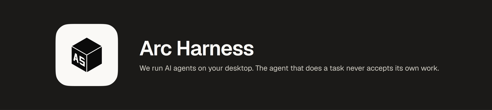
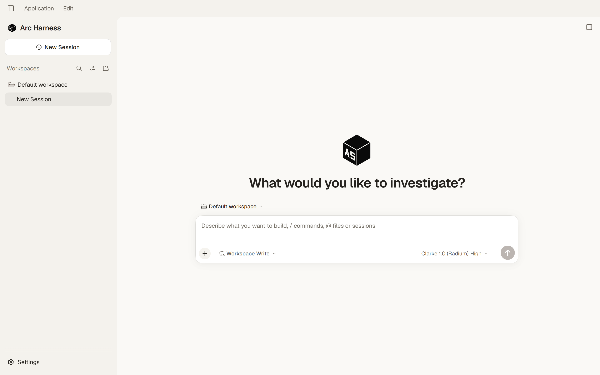
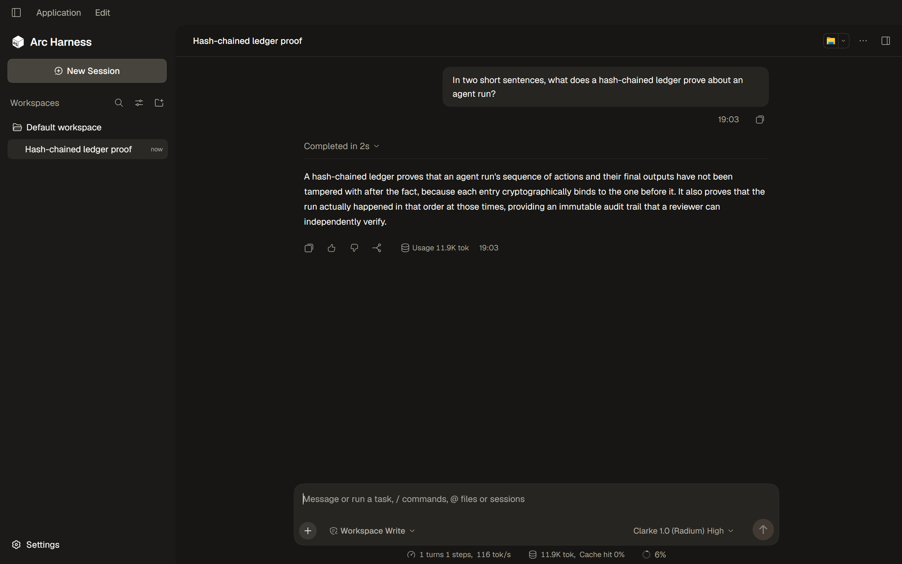
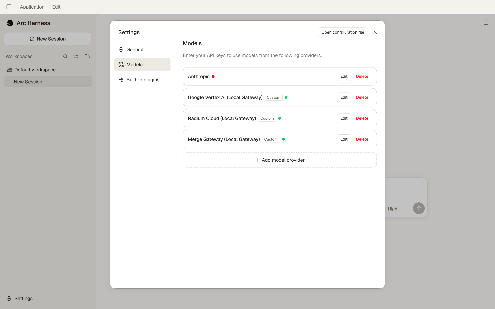
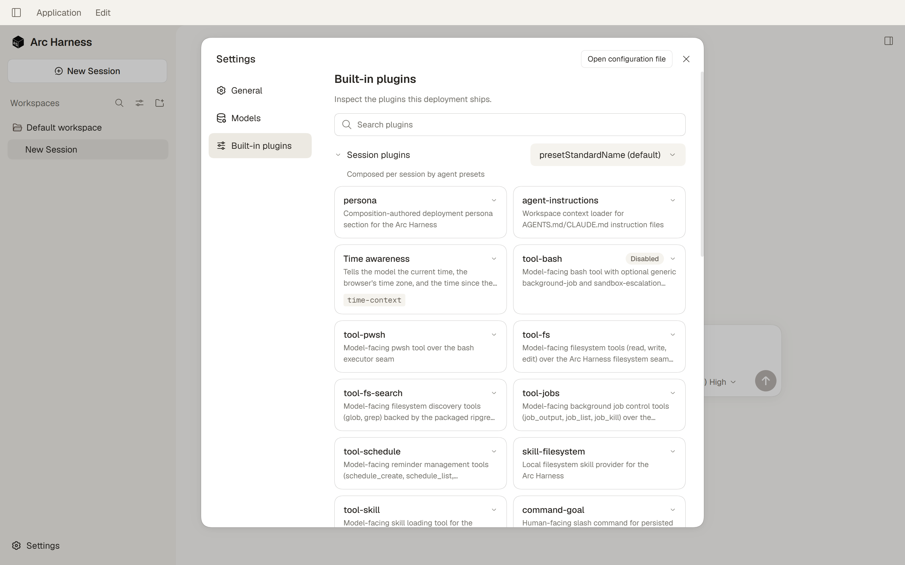

  

  
  
  
  
  
  

  <a href="#screens">Screens</a> &nbsp;&nbsp;
  <a href="#how-it-works">How it works</a> &nbsp;&nbsp;
  <a href="#road-map">Road map</a> &nbsp;&nbsp;
  <a href="#build-and-install-windows">Install</a> &nbsp;&nbsp;
  <a href="https://github.com/danilkotelnikov/Arc-Science/wiki">Wiki</a>

  

## What it is

Arc Harness is a desktop app where an AI model works in sessions. It reads and edits files in a workspace, runs shell commands within the permission mode you choose, and calls tools. Its goal is a scientific harness that never grades its own work.

This repository holds the build kit and the two Arc plugins. It does not contain the original app: you bring your own copy.

| What you get | How it works |
|---|---|
| **No self-approval** | Work passes propose, freeze and an independent accept gate. |
| **A record you can check** | Each step goes into a hash-chained ledger, and the Trace tab shows it. |
| **Your models** | Anthropic, OpenAI and many more, with your own keys on the Models page. Google Vertex runs through a local gateway. |
| **Shared memory** | A Cammut memory server gives each session a short memory brief. |
| **No vendor links** | No update feed, no telemetry and no connections to the original vendor. A network test proves it. |
| **A real test** | A journey test opens the desktop app, clicks through Settings and waits for a real model reply. |

## Screens

These are captures of the running app, made by `test/desktop-journey.mjs --mode shots`.

| | |
|---|---|
|  |  |
| **Home.** Start a session in a workspace. | **Warm dark look.** Light, Dark or System. |
|  |  |
| **A session.** A real model reply. | **Models.** Add providers and keys. A green dot means connected. |
|  |  |
| **General settings.** | **Built-in plugins.** A read-only list of what ships. |

## How it works

**One request.** In this setup, gateway providers and memory go through one local gateway. It adds your keys and refuses unsafe writes. A provider with its own key connects directly.

**One task.** The agent proposes, the work is frozen, and another reviewer gates it.

**One build.** The kit turns your copy of the original app into Arc Harness.

### See the rails work

A task is accepted only when five gates pass:

Memory search merges four ranked lists, then a reranker improves the top 5:

Three more clips are in [media](media/README.md): [when a patch is truly better](media/better.mp4), [a small model learns the big one](media/student.mp4) and [ten times smaller context](media/context.mp4). Each clip marks its numbers as concept values, targets or measured.

## Road map

The app comes first, then claims, then proof. The full plan is on the [Roadmap](wiki/Roadmap.md) page.

## What the build changes

| Change | How |
|---|---|
| AS cube logo, product name, ink icons, no blue or violet | `tools/build.mjs`, patches 1 to 10 |
| No update feed, no telemetry, no connections to the original vendor | patches 9 and 11 |
| Light first run, the cream look in Light and a warm dark set in Dark | patch 7 and the theme plugin |
| "Thinking" and "Thinking for 2s" as the running label | patch 13 |
| Lean core: no plugin manager page (Settings keeps a read-only Built-in plugins section), Automation tasks, trajectories, skills, account, subagent and agent preset screens | patch 14 (one `disabled: true` line per screen) |
| No "Show coding view" row in General settings | patch 15 |
| Data folder `~/.arc` and its variable `ARC_HOME` | patch 16 |
| Clean room: every internal name moves to Arc. Packages are `@arc-harness/arc-*`, the runtime folder is `arc/`, and the command and link name is `arc` | patch 17 and `lib/arcnames.mjs` (the build stops if one old name is left) |
| Lean profile: 4 bundles (`@arc-harness/arc-base`, `@arc-harness/arc-web-app`, `arc-theme`, `arc-hoh`) | `tools/lean-profile.mjs`, with an undo list |

## The Arc plugins

| Plugin | What it does |
|---|---|
| `plugins/arc-hoh` | Harness of Harness. Every task goes through propose, freeze and an independent accept gate. Each step is written to a hash-chained ledger. The Trace tab in the right sidebar shows the ledger, newest first, with the chain check, and the memory brief the agent reads. |
| `plugins/arc-theme` | The cream and warm dark skin, with Geist type, ink icons and short motion: menus, dialogs, panels, lists and toasts move with GSAP-style ease curves, on transform and opacity only, so the graphics card does the work. Reduced motion in Windows turns it off. |

The memory brief and the gate verdicts use a Cammut memory server through a local gateway at `127.0.0.1:7424`. Without one, the plugin keeps working and the brief stays empty.

## Build and install (Windows)

You need Node.js 22.19 or newer and an installed copy of the original app, version 0.2.1-rc.5 (see [Credit](#credit-and-licence)).

1. Copy `app.asar`, `app-update.yml`, `icon.png` and `tray.ico` from the `resources` folder of the original app into `pristine\`.
2. Check them against `pristine/SHA256SUMS.txt`.
3. Run `node tools/build.mjs`. The build stops if a patch does not find its text.
4. Run `node test/build-check.mjs build/app.asar <scratch folder>`.
5. Close the app. Run `install.cmd`. To undo, run `install.cmd rollback`.
6. Copy `plugins/arc-hoh` and `plugins/arc-theme` into `~/.arc/profiles/<profile>/node_modules`.
7. Run `node tools/lean-profile.mjs apply`. A plugin loads only when the bundle list names it, and this step adds both. It stops, and changes nothing, if a plugin is missing from a profile, so copy them into both `web` and `desktop`. `restore` undoes it. The original lists are saved per data home (`--home`, `ARC_HOME` or the default), so each home restores its own.

Set `ARC_RESOURCES` or `ARC_APP_DIR` when the app is installed somewhere else.

## Checks

| Check | Command |
|---|---|
| Build check (hashes, every patch, brand files) | `node test/build-check.mjs build/app.asar <scratch>` |
| Every screen in first run, dark and light, in a throwaway data home | `node test/ui-crawl.mjs --lean [--plugin plugins/arc-hoh]` |
| No old brand wording | `node test/ui-strings.mjs`, `node test/independent-scan.mjs` |
| No connection to the original vendor | `node test/no-deepseek-net.mjs --live` |
| The scans really find things (on the original archive) | `node test/positive-control.mjs` |
| The desktop app with real clicks and a real model reply | `node test/desktop-journey.mjs --mode settings`, then `reply`, then `retry` |
| Plugin tests | `node --test plugins/arc-hoh/test/hoh.test.mjs`, `node --test plugins/arc-theme/test/theme.test.mjs` |
| Privacy scan before a push | `node scripts/privacy-scan.mjs` |

## Project health

| | |
|---|---|
| [Contributing](CONTRIBUTING.md) | How to change the kit and what to run |
| [Security policy](SECURITY.md) | How to report a problem privately |
| [Code of conduct](CODE_OF_CONDUCT.md) | How we work together |
| [Changelog](CHANGELOG.md) | What changed, and when |
| [Citation](CITATION.cff) | How to cite Arc Harness |
| [Wiki pages](wiki/Home.md) | Install, keys, Cammut server, tests and FAQ |

CI actions are pinned to full commit SHAs, and Dependabot keeps them current.

## Known limits

- The app keeps its data in `~/.arc` (set `ARC_HOME` to move it). The first install copies the old `~/.dsh` there with Arc names in settings, profiles, plugins and skills. Conversations, logs and keys are copied byte for byte. `~/.dsh` stays as it was, so `install.cmd rollback` gets the original app back with its data.
- The installed app still uses the original program file name, install folder and Start menu name.
- The design-token prefixes `dsw-` and `ds-` of the original interface stay, as do real model names in the third-party model catalog.
- The plugin manager is switched off in the lean core, so plugins are installed by copying.
- The local gateway and its Google Vertex route are a separate small program. They are not in this repository yet.
- On a network that drops large uploads, model calls need a local proxy. If the proxy stops, requests fail until it returns, and the app shows its retries.
- The Built-in plugins page shows one raw label, `presetStandardName`.
- Only Windows is tested.

## Credit and licence

Arc Harness is built on [DeepSeek Harness](NOTICE.md) 0.2.1-rc.5, which is MIT licensed. Arc Harness is an independent project and is not affiliated with its publisher.

The code here is MIT (`LICENSE`). The AS cube logo is an exception. `NOTICE.md` and `THIRD_PARTY_LICENSES/` hold the licence texts.
