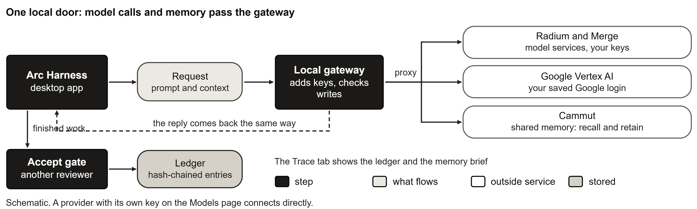
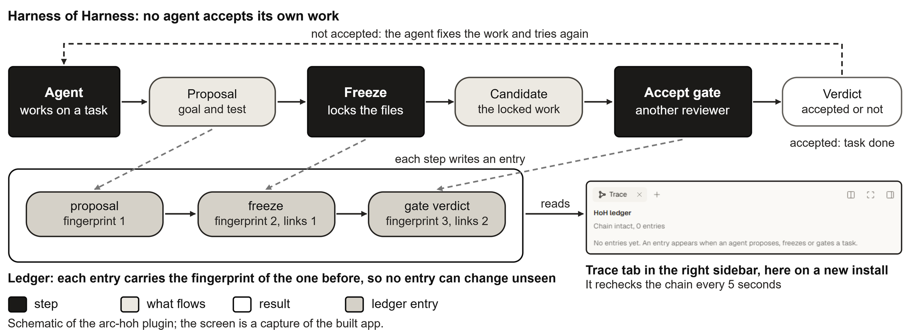
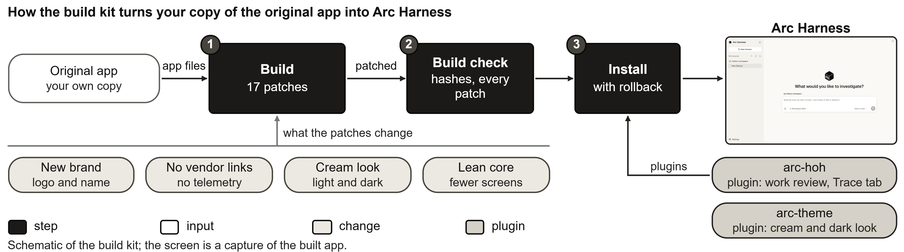
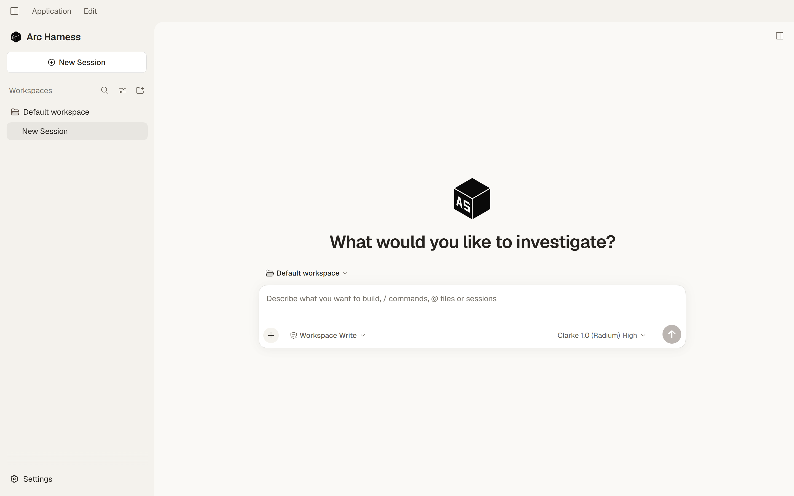
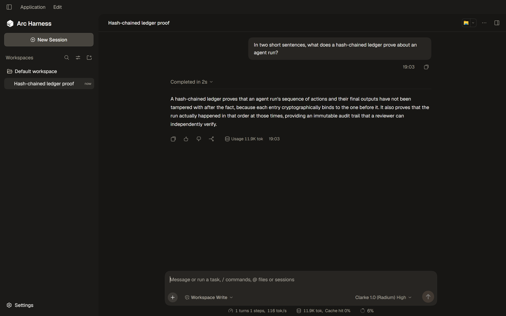
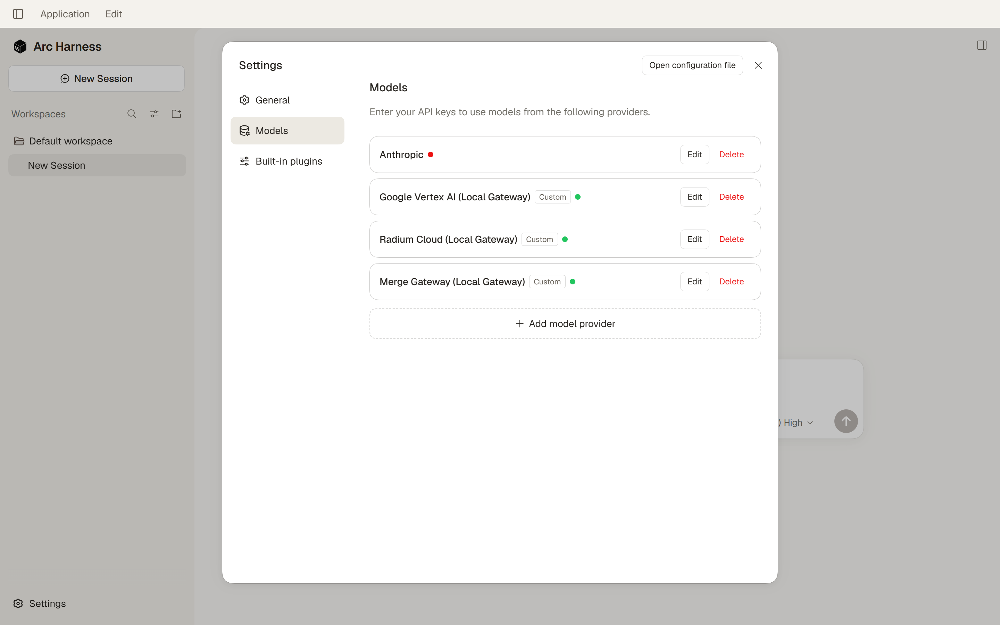

# How it works

Status: Works today. The Google Vertex route and the local gateway are a separate small program, outside this repository.

## One request

In this setup, gateway providers and memory go through one local gateway. It adds your keys, refuses writes without its token, and reaches the outside services. A provider with its own key on the Models page connects directly.

## One task

The agent proposes, the work is frozen, and another reviewer gates it. Each step goes into a hash-chained ledger, and the Trace tab reads it. No agent accepts its own work.

## One build

The kit turns your copy of the original app into Arc Harness. The build stops if a patch does not find its text.

## What it looks like

