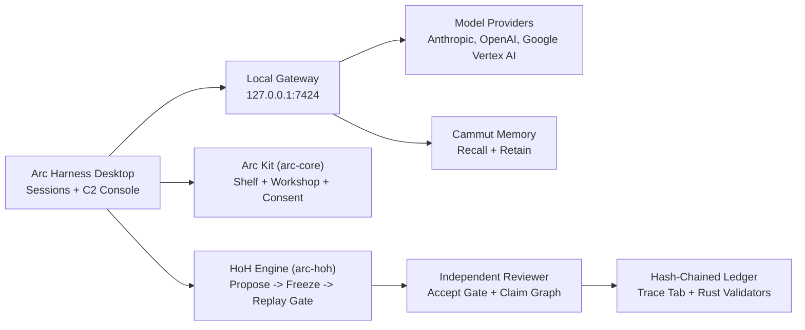

# How it works

Status: Works today in version 0.5.0. The local gateway runs alongside the desktop host on `127.0.0.1:7424`.

## Architecture

## Request path

Gateway providers and shared memory pass through one local gateway at `127.0.0.1:7424`. It injects provider credentials outside workspace files, preserves Google `thought_signature` across streamed and parallel Gemini tool calls, and refuses unauthenticated writes. Providers configured directly on the Models page connect from the desktop host.

## Verification loop

The agent proposes a task hypothesis, freezes the candidate files by SHA-256 digest, and hands the candidate to an independent reviewer at the accept gate (`arc-hoh`). Each step appends a linked digest to the ledger, and the Trace sidebar tab verifies the chain every 5 seconds.

## Build pipeline

`node tools/build.mjs` applies 19 deterministic steps to your `pristine/app.asar`, writes `build/app.asar` and `build/BUILD.json`, and fails immediately if any target pattern is missing. `tools/package.mjs` stages a standalone `Arc Harness.exe` build for Inno Setup.

## Interface captures

